<div align="center">

# cli-dashboard

**A live session dashboard for Claude Code, drawn right under your prompt.**

Context health, rate limits, subagents, tasks and skills, all in one bordered panel that updates as you work.

**Alpha** · v0.2.0

</div>

<p align="center">
  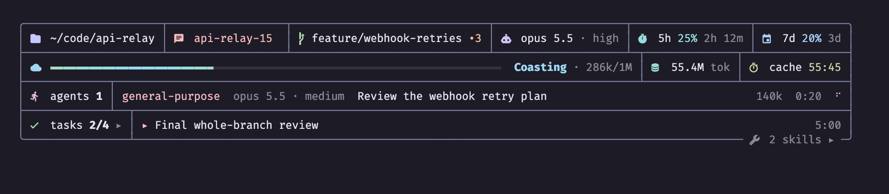
</p>

> Inspired by [**YAS! (Yet Another Statusline)**](https://github.com/tmck-code/yet-another-statusline) by tmck-code. Go give it a star.

## Highlights

- **The Dumb Meter**: see how full your context is at a glance, from **Smart** to **Dumb**, with a bar that flows warmer as it fills.
- **Rate limits with a burn rate**: your 5-hour and 7-day limits turn **peach**, then **rose**, when you're using them faster than the window allows.
- **Live subagents**: every agent's model, effort, tokens and running time, with a spinner until it's done.
- **Tasks at a glance**: progress and the task in progress. Click to see the full list.
- **Make it yours**: five colour themes, plain icons for any font, and calm or still animation, picked in a guided `/cli-dashboard-setup` with a live preview.
- **Fits any terminal**: the panel grows with what's going on and shrinks to fit a narrow window.
- **Two commands to install**: no cloning, no config files.

> [!NOTE]
> cli-dashboard is in **alpha**. Expect rough edges, and expect the layout to change between releases.

## Contents

- [Quick start](#quick-start)
- [See it in action](#see-it-in-action)
- [The Dumb Meter](#the-dumb-meter)
- [Make it yours](#make-it-yours)
- [Using it](#using-it)
- [Roadmap](#roadmap)
- [Reference](#reference)
  - [What each row shows](#what-each-row-shows)
  - [Fonts](#fonts)
  - [Settings](#settings)
  - [How the soft limit is chosen](#how-the-soft-limit-is-chosen)
  - [Narrow terminals](#narrow-terminals)
  - [Updating and uninstalling](#updating-and-uninstalling)
  - [Troubleshooting](#troubleshooting)
  - [Known limits](#known-limits)
- [Development](#development)
- [Credits](#credits)
- [License](#license)

## Quick start

You need **Claude Code 2.1.295 or later** (`claude --version`; run `claude update` if it is older).

```sh
claude plugin marketplace add iqmalje/cli-dashboard
claude plugin install cli-dashboard@cli-dashboard
```

Then start a new session:

```sh
claude
```

That's it. The panel appears under the prompt. Sessions that were already open don't pick it up, so restart them.

Then run `/cli-dashboard-setup` to pick a look (optional: the default is the recommended `pastel`). Icons look like boxes? Pick `plain` icons there, or install a Nerd Font (see [Fonts](#fonts)).

## See it in action

The panel grows and shrinks with what is going on and how wide your terminal is.

**Full**: subagents running, tasks open, skills shown (132 columns). Each part is labelled.

<p align="center">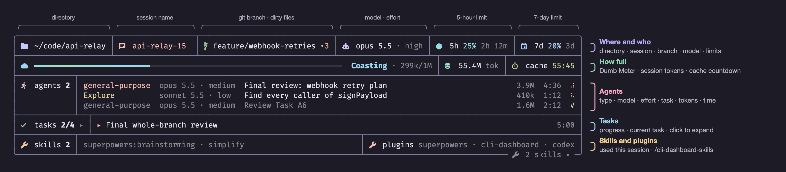</p>

**Partial**: the everyday view, with the two fixed rows and the current task (112 columns).

<p align="center">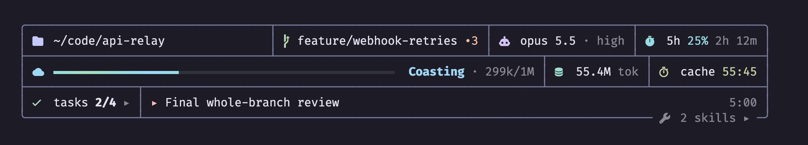</p>

**Shrunken**: a narrow terminal (76 columns).

<p align="center">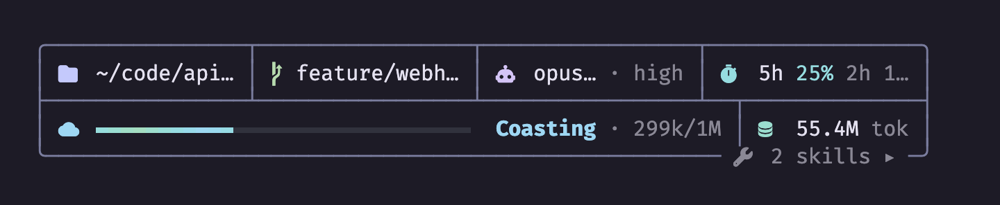</p>

**Burn rate**: your 5-hour limit, half-way through its window. Under 50% used is on track (blue), a little over is a warning (peach), well over is rose.

<p align="center">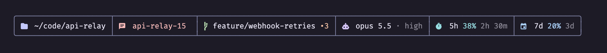</p>

**Resizing**: cells step aside as the terminal narrows and come back as it widens.

<p align="center">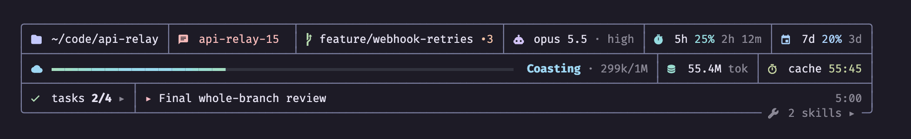</p>

## The Dumb Meter

The meter shows how full your context is, named by how much room is left before the model starts to slip:

<p align="center">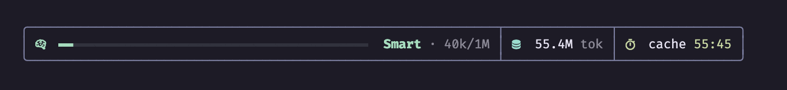</p>

| Fill | State |
| --- | --- |
| under 25% | **Smart** |
| 25–50% | **Coasting** |
| 50–70% | **Foggy** |
| 70–90% | **Cooked** |
| 90% and over | **Dumb** |

<p align="center">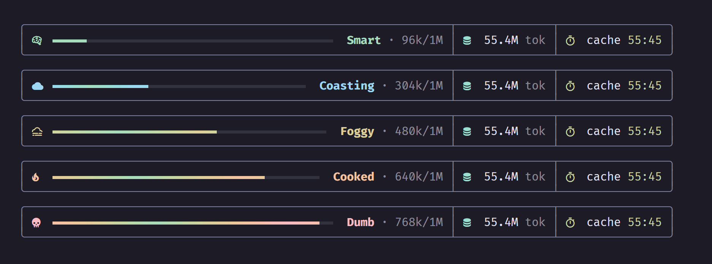</p>

The gradient runs from Smart's green to the colour of the current state and flows along the bar. While the meter is **Smart**, both ends are the same green, so the bar looks still. The flow shows from **Coasting** on, and grows stronger as the meter heads for **Dumb**.

"Full" is a **soft limit** picked for your model, not the raw context window. See [How the soft limit is chosen](#how-the-soft-limit-is-chosen), or set your own in [Settings](#settings).

## Make it yours

Run `/cli-dashboard-setup`. A pane opens and asks four questions, one at a time, with a live preview of your panel under each:

<p align="center">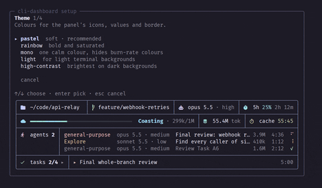</p>

| Question | Choices |
| --- | --- |
| **Theme** | `pastel` soft, recommended · `rainbow` bold and saturated · `mono` one calm colour · `light` for light terminal backgrounds · `high-contrast` brightest on dark backgrounds |
| **Icons** | `nerd` needs a Nerd Font · `plain` works in any font |
| **Animation** | `full` colour flow, colour cycling and spinner · `calm` spinner only · `off` nothing moves |
| **Colour animation speed** | `1x` · `0.5x` slower · `2x` faster. Skipped when animation is `off`. |

↑ / ↓ move through the choices and the preview follows. **Enter** picks and moves on, and **Esc** cancels without saving anything. After the last question your picks are saved, a toast confirms them, and the panel switches at once.

You can change any of them later the same way, or one at a time in `/config` (see [Settings](#settings)).

<details>
<summary><b>The themes side by side</b></summary>

<p align="center">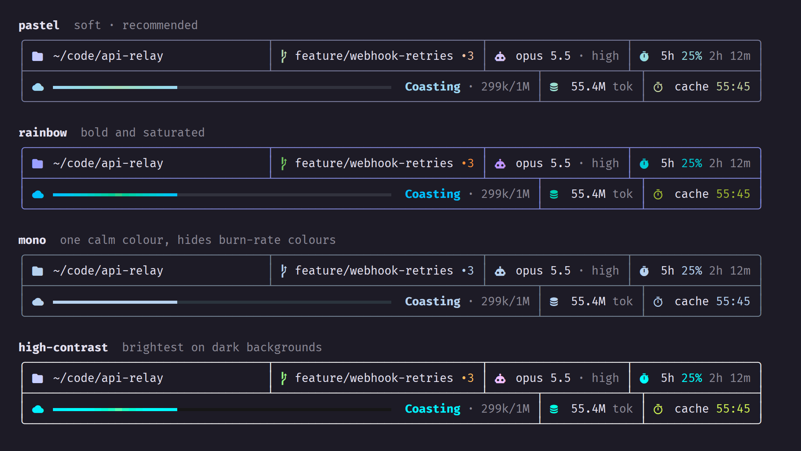</p>

`light` is made for light terminal backgrounds:

<p align="center">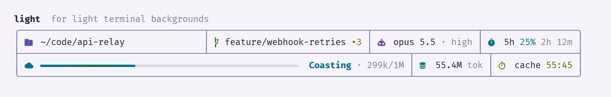</p>

</details>

`mono` draws everything in one colour, so the burn-rate warning colours and the meter's state colours go with it.

## Using it

| Action | How |
| --- | --- |
| Expand or collapse the task list | Click the **tasks** row |
| Scroll the agent rows (5 show at a time) | Click the **agents** rows, then press ↑ / ↓ |
| Show or hide skills and plugins | Click **skills** in the bottom border, or run `/cli-dashboard-skills` |
| Pick the theme, icons and animation | Run `/cli-dashboard-setup` (see [Make it yours](#make-it-yours)) |

Finished agents stay on the panel with a ✓ until your next prompt, so you can see how they ended.

## Roadmap

Shipped so far: colour themes, plain icons and animation choices (see [Make it yours](#make-it-yours)). Still planned:

- **Meter states**: rename the five states and move their thresholds.
- **Sections and cells**: choose which ones show, and in what order.

Ideas and requests are welcome in [issues](https://github.com/iqmalje/cli-dashboard/issues).

## Reference

### What each row shows

| Row | What you see |
| --- | --- |
| **Where and who** | Working directory, session name, git branch with a dirty-file count, model and effort, and your 5-hour and 7-day rate limits with time to reset. The limit percentage shows your burn rate: **blue** under an even pace for the window, **peach** up to 5 points over it, **rose** beyond that. |
| **How full** | The **Dumb Meter** (context fill), the session's total tokens, and a countdown to when the prompt cache expires. |
| **Agents** | One row per subagent: type, model and effort, task, live token count, elapsed time, and a spinner or ✓. Workflow agents get their own section, named after the run. |
| **Tasks** | Progress (`done/total`) and the task in progress. Click to expand the full list. |
| **Skills** | The skills used this session and the enabled plugins. Toggle with `/cli-dashboard-skills` or a click. |

The agents, tasks and skills sections only appear while they have something to show.

### Fonts

The panel needs two kinds of glyphs from your terminal font:

- **Icons**: [Nerd Font](https://www.nerdfonts.com/font-downloads) icons for every cell. Without them each icon is a box or a `◆`; or pick `plain` icons with `/cli-dashboard-setup`.
- **The meter bar**: `U+1FB0B`, from Unicode's *Symbols for Legacy Computing* block. Without it the bar is a row of `�`.

Not every Nerd Font has both, and not every terminal falls back to another font for a missing glyph. Windows Terminal, for one, does not reliably fall back.

| Font | Icons | Meter bar |
| --- | --- | --- |
| **Cascadia Mono NF** / **Cascadia Code NF** | ✓ | ✓ |
| FiraCode Nerd Font | ✓ | only through your terminal's font fallback |
| JetBrainsMono Nerd Font | ✓ | ✗ in Windows Terminal |
| Cascadia Mono (Windows Terminal's default) | ✗ | ✓ |

**Cascadia Mono NF** is the safest pick. It is Microsoft's own Nerd Font build of Cascadia, and it ships in the zip on the [Cascadia Code releases page](https://github.com/microsoft/cascadia-code/releases).

**macOS**: install a Nerd Font and select it in your terminal (for example iTerm2: Settings → Profiles → Text → Font).

```sh
brew install --cask font-fira-code-nerd-font
```

**Windows (including WSL)**: the font goes on **Windows**, not inside WSL, because Windows Terminal draws the text.

1. Download the zip from the [Cascadia Code releases page](https://github.com/microsoft/cascadia-code/releases), open `ttf/`, right-click `CascadiaMonoNF.ttf` and choose **Install**.
2. In Windows Terminal, open **Settings → Defaults → Appearance → Font face** and pick **Cascadia Mono NF**. A profile's own font overrides the default, so check your WSL profile too. In `settings.json` the same setting is:

   ```json
   "profiles": { "defaults": { "font": { "face": "Cascadia Mono NF" } } }
   ```

3. Close every Windows Terminal window, then start a new `claude` session.

### Settings

`/cli-dashboard-setup` sets the last four for you (see [Make it yours](#make-it-yours)). Every setting is also a row in `/config`, where a change applies to the open session at once.

| Setting | What it does | Default |
| --- | --- | --- |
| `softLimit` | Context tokens the Dumb Meter treats as full. Capped at the model's context window. | Per model (see [How the soft limit is chosen](#how-the-soft-limit-is-chosen)) |
| `theme` | Colour palette: `pastel` (recommended), `rainbow`, `mono` (one hue; hides the burn-rate colours), `light` or `high-contrast`. | `pastel` |
| `icons` | `nerd` needs a Nerd Font; `plain` uses single-width Unicode symbols any terminal draws. | `nerd` |
| `animation` | `full` flows the gradient, cycles hues and spins; `calm` keeps only the spinner moving; `off` draws a static panel. | `full` |
| `speed` | **Colour animation speed**: how fast the meter gradient and agent colours shift (the spinner keeps its pace): `1x`, `0.5x` or `2x`. | `1x` |

A value outside a setting's choices counts as unset, so its default applies.

Or set them from a terminal:

```sh
echo '{"softLimit": "400000"}' | claude plugin configure cli-dashboard@cli-dashboard --values-stdin
echo '{"theme": "rainbow"}' | claude plugin configure cli-dashboard@cli-dashboard --values-stdin
```

Restart your sessions to apply a change made this way. To put `softLimit` back to the per-model default, set it to `0`.

### How the soft limit is chosen

The Dumb Meter measures context tokens against a **soft limit**, the point it treats as full. The default depends on the model:

| Model | Default soft limit | Why |
| --- | --- | --- |
| Claude 5 models (Fable, Opus, Sonnet, Haiku 5.x) on a 1M window | **800K** | Their system cards report long-context results across the full 1M window with no published drop-off point. |
| Claude 4.x and older on a 1M window (Opus 4.6–4.8, Sonnet 4.6) | **512K** | Opus 4.6 measurably degrades past 256K (MRCR v2, 8 needles: 93.0 at 256K, 76.0 at 1M), so the meter turns Foggy at 256K. |
| Any model on a 200K window (Haiku 4.5, Opus 4.5, Sonnet 4.5) | **200K** | The window itself. |

### Narrow terminals

When the top row runs out of room, the panel gives things up in a fixed order: it shortens the directory, then hides the 7-day limit, the session name, the dirty count and the cache countdown. It then takes back anything that fits again, so a long session name never costs you the 7-day limit. Anything still too long is cut with `…`.

### Updating and uninstalling

Update:

```sh
claude plugin marketplace update cli-dashboard
claude plugin update cli-dashboard@cli-dashboard
```

Restart your sessions to load the new version.

Uninstall:

```sh
claude plugin uninstall cli-dashboard@cli-dashboard
claude plugin marketplace remove cli-dashboard
```

### Troubleshooting

| Problem | Fix |
| --- | --- |
| No panel under the prompt | Run `claude plugin list` and check that `cli-dashboard@cli-dashboard` says **enabled**, then start a new session. |
| No panel, and the plugin is enabled | Check `claude --version` is 2.1.295 or later. Older versions don't run mods. |
| Boxes or `◆` instead of icons | Your font has no Nerd Font icons. Install one and select it in your terminal (see [Fonts](#fonts)), or pick `plain` icons with `/cli-dashboard-setup`. |
| Colours hard to read | On a light terminal background, pick the `light` theme; for more contrast on a dark one, `high-contrast` (run `/cli-dashboard-setup`). |
| "could not save the picks" toast | The picks apply to this session only. Check that `claude` is on your `PATH` and `claude plugin list` shows the plugin, then run `/cli-dashboard-setup` again. |
| `�` along the meter bar | Your font has no `U+1FB0B`. Switch to **Cascadia Mono NF** (see [Fonts](#fonts)). |
| The meter bar doesn't flow | Expected while the meter is **Smart**: the gradient is one colour until **Coasting** (see [The Dumb Meter](#the-dumb-meter)). |
| No branch cell | The panel only shows a branch inside a git repository, with `git` on your `PATH`. |

### Known limits

- The panel sits below Claude Code's mode line (`auto mode on (shift+tab to cycle)`). The terminal draws that line itself, and a mod cannot draw above it from under the prompt.
- Live agent tokens are read from transcripts on disk every 2 seconds. A transcript over 4 MiB cannot be read, so its count stops at the last value read.
- The cache countdown assumes a 1-hour prompt cache. Sessions on an API key get a 5-minute cache by default, so their countdown runs too long. A fix is planned.
- After `/clear` or `/resume`, the panel catches up within about 2 seconds. The token total restarts at 0 for the resumed session.

## Development

To work on the mod, load it from a clone instead of the marketplace (uninstall the marketplace copy first, or the panel draws twice):

```sh
git clone https://github.com/iqmalje/cli-dashboard.git ~/Documents/cli-dashboard
```

Then add the folder to `CLAUDE_CODE_PLUGIN_DIRS` in the `env` block of `~/.claude/settings.json`. Separate several folders with a colon:

```json
{
  "env": {
    "CLAUDE_CODE_PLUGIN_DIRS": "~/Documents/cli-dashboard"
  }
}
```

Open sessions reload the mod's code by themselves when its files change.

To try a branch for one session without touching your install, disable the marketplace copy and start Claude Code from the folder:

```sh
claude plugin disable cli-dashboard@cli-dashboard
claude --plugin-dir ~/Documents/cli-dashboard
claude plugin enable cli-dashboard@cli-dashboard   # afterwards
```

A copy loaded from a folder keeps its settings under `cli-dashboard@inline`, apart from the installed copy's.

The code is plain TypeScript: pure functions over immutable data, with the I/O in one hooks module.

```
hooks/
  register.tsx   event hooks, the panel render and the setup pane (the only module with I/O)
  rows.ts        builds the panel's rows and cells from session data
  look.ts        themes, icon sets and animation: the settings' choices and what they draw
  setup.ts       the setup wizard's questions and steps
  sample.ts      made-up agents and tasks for the setup preview and the screenshots
  frame.ts       lays out cells into a bordered frame that fits the width
  meter.ts       Dumb Meter maths
  agents.ts      agent rows: spawn, stop, tokens, effort, scrolling
  tasks.ts       task list from TaskCreate / TaskUpdate / TodoWrite calls
  format.ts      durations, token counts, model names, paths
  color.ts       OKLCH colours and the flowing gradient
  scroll.tsx     the focusable agents region (↑ / ↓)
types/           the panel's own types and its state shape
tools/
  screenshots/   renders the README images from the drawing code
CONTEXT.md       the project's vocabulary (Panel, Cell, Dumb Meter, ...)
```

Run the tests:

```sh
claude plugin test .
```

Type-check:

```sh
npx -p typescript tsc --noEmit -p .
```

`tsconfig.json` extends `.claude-plugin/types/tsconfig.json`. Claude Code writes that folder (the engine's API types) the first time it loads the mod, so start one session with the mod installed before you type-check. It is git-ignored.

Regenerate the README images after a visual change (needs [Bun](https://bun.sh), Google Chrome or Chromium, [gifski](https://gif.ski) (`brew install gifski`) and FiraCode Nerd Font):

```sh
bun tools/screenshots/render.ts
ONLY=hero,burn bun tools/screenshots/render.ts   # just these
```

The script draws the panel with the mod's own code and writes `docs/images/`: the full, partial and shrunken panels, the meter's states, the setup pane and the themes as PNGs, and the hero, meter, burn-rate, resize and setup animations as GIFs, one frame per 120 ms panel tick. A full run takes about two minutes. The data in it is made up. The paths default to macOS. Set `CHROME` to the Chrome or Chromium binary and `FONTS` to the folder holding `FiraCodeNerdFont-Regular.ttf` and `-Bold.ttf` to render elsewhere (Linux and WSL work too).

### A note on events

On Claude Code 2.1.295, the `classic.*` hook events (`SessionStart`, `PostToolUse`, `Stop`, `SubagentStop`, and the rest) never reach a mod, although the API types document them. The panel uses only events that do arrive: `session.start`, `turn.step`, `turn.complete`, `prompt.submit`, `agent.spawn` and `tool.call`. Check that an event fires before you build on it.

## Credits

- [**YAS! (Yet Another Statusline)**](https://github.com/tmck-code/yet-another-statusline) by tmck-code, the statusline this project grew out of. cli-dashboard started as a mod that shows what YAS shows, live and clickable, under the prompt. If you want a statusline, use YAS.
- [**Dumbometer**](https://github.com/MaximoCorrea1/dumbometer) by Maximo Correa Rosas, for the Smart → Dumb state words and their thresholds, which YAS ported and this project reuses.

## License

[MIT](LICENSE) © 2026 Iqmal Aizat
